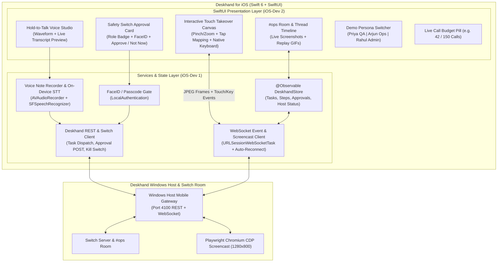

# Deskhand for iOS — End-to-End Product & Engineering Plan

> **Product Role:** Mobile Command Center, Voice Task Studio, 1-Tap Team Safety Switch & Interactive Touch Screen Takeover  
> **Team Allocation:** 2 iOS Engineers (`iOS-Dev 1` & `iOS-Dev 2`)  
> **Target Stack:** Swift 6, SwiftUI, iOS 18+, Observation Framework, `Speech` + `AVFoundation` (On-Device Voice Notes), `URLSessionWebSocketTask` (Live Step Feed & CDP Touch Takeover), `LocalAuthentication` (FaceID Approval Guard), `ActivityKit` (Dynamic Island / Live Activities)  
> **Hackathon Deadline:** November 7, 2026, 11:59 PM IST (Target submission: **Nov 7, 8:00 PM IST**)  
> **Track:** 01 — Best Business Workflow (*Flip the Switch Hackathon*)

---

## 1. Executive Summary & Product Vision

**Deskhand for iOS** turns any teammate's iPhone into a live remote control and safety switch for the team's shared computer running on the **Deskhand Windows Host** and **Switch `#ops` room**.

In the **Chai Co.** demo story, teammates aren't chained to their desks:
1. **Voice from a Phone (Demo Scene 2):** Arjun is away from his laptop. He holds the microphone button in Deskhand for iOS and speaks: *"Update the masala chai price to 249 in the store admin and tell the team."* On-device Apple Speech recognition transcribes the voice note instantaneously (**consuming `0` API calls from the 150-call budget!**) and dispatches the audio + transcript to the `#ops` Switch room and Windows Host.
2. **Live Step Stream in Your Pocket:** As Deskhand's Windows Chromium sandbox clicks through the store or admin panel, every annotated screenshot streams live into the iOS thread view (and updates a **Dynamic Island / Lock Screen Live Activity**).
3. **1-Tap Safety Switch with Role & FaceID Verification (Demo Scene 2):** When Deskhand reaches the **Save Price Update** button, it pauses and triggers an urgent **Approve / Not now** card on Priya's iPhone: *"Change Masala Chai from ₹229 to ₹249?"* showing the live before/after screenshot. Priya taps **Approve**, confirms with FaceID, and Deskhand completes the save.
4. **Interactive Touch Takeover (Demo Scene 3):** When Deskhand hits a 2FA login code screen it cannot read, Rahul taps **"Take Over Screen"** on his iPhone. The iOS app opens a live interactive canvas streamed from the Windows Host's Chromium browser (`1280x800`), maps Rahul's pinch-zoom and tap directly onto the OTP input field, brings up the native iOS numeric keypad to type the code, and lets him tap **"Hand Back to Deskhand"**.

---

## 2. System Architecture (iOS Companion App)



---

## 3. Xcode Project & Module Structure

Designed so **`iOS-Dev 1` (Networking, Voice, WebSocket & Takeover Engine)** and **`iOS-Dev 2` (SwiftUI Screens, Approvals, Animations & Demo Polish)** never edit the same files:

```text
deskhand/ios/DeskhandMobile/
├── DeskhandMobileApp.swift
├── Models/                        # Shared Swift Codable structs (mirrors packages/shared-protocol)
│   ├── TaskModels.swift           # TaskItem, StepScreenshot, RiskLevel, TaskStatus
│   ├── ApprovalModels.swift       # ApprovalRequest, ApprovalDecision, TeamPersona
│   └── TakeoverModels.swift       # ScreencastFrame, RemoteTouchEvent, RemoteKeyEvent
├── Services/                      # Owned by iOS-Dev 1
│   ├── DeskhandWebSocketService.swift   # Real-time task stream + CDP takeover frames
│   ├── DeskhandAPIClient.swift          # REST calls (/api/tasks, /api/approval, /api/kill)
│   ├── VoiceNoteService.swift           # AVAudioRecorder + SFSpeechRecognizer (0 API call STT!)
│   ├── TakeoverInputMapper.swift        # Maps iPhone CGPoint -> 1280x800 Chromium coordinates
│   └── MockDemoServer.swift             # Offline deterministic mock mode for UI testing
├── Features/                      # Owned by iOS-Dev 2
│   ├── Feed/
│   │   ├── OpsRoomView.swift            # Main #ops chat + live agent step stream
│   │   ├── StepCarouselView.swift       # Annotated screenshot viewer + GIF replay player
│   │   └── StatusHeaderBar.swift        # Host connection indicator + 150 Call Budget pill
│   ├── Voice/
│   │   └── VoiceCommandBar.swift        # Hold-to-talk button, live waveform, send sheet
│   ├── Approvals/
│   │   ├── ApprovalGateCard.swift       # High-contrast Approve / Not Now card in thread
│   │   ├── ApprovalModalSheet.swift     # Side-by-side price diff (₹229 -> ₹249) + FaceID
│   │   └── BiometricAuthHelper.swift    # LocalAuthentication wrapper
│   ├── Takeover/
│   │   └── TouchTakeoverSheet.swift     # Full-screen interactive browser canvas + keyboard bar
│   └── Demo/
│       └── PersonaSwitcherBar.swift     # 1-tap switch between Priya, Arjun & Rahul for demo recording
└── Widgets/                       # Owned by iOS-Dev 2 (Stretch / Polish)
    └── DeskhandLiveActivity.swift       # Dynamic Island step progress & "Approval Needed" badge
```

---

## 4. Detailed Feature Specifications (iOS Product)

### 4.1 `#ops` Room Timeline & Live Step Feed (`iOS-Dev 2`)
- **Thread-First Layout:** Mirrors the `#ops` Switch room in real time. Each Deskhand task appears as an expandable live card showing:
  - The triggering prompt (text or voice note waveform + transcript).
  - A horizontal auto-advancing **Step Carousel** where each step displays its screenshot, the red click indicator rendered by the Windows Host, and a concise 1-line caption (e.g., *"Step 3: Applied coupon `CHAI50` — detected 500 Checkout Error"*).
  - **1-Tap Quick Actions:** When Deskhand posts the ready-to-file QA bug report in Demo Scene 1, a prominent **"File it in Issue Tracker"** pill lets Rahul trigger the bug filing with a single tap or short reply.
  - **Replay GIF Viewer:** Automatically loops the summary `GIF` once the task completes.

### 4.2 Hold-to-Talk Voice Studio with Zero-Cost On-Device STT (`iOS-Dev 1` + `iOS-Dev 2`)
- **Why On-Device STT Matters for the Hackathon:** The total call budget is capped at **150 calls** (with only 10 allocated for STT). By using Apple's native `SFSpeechRecognizer` (`requiresOnDeviceRecognition = true`) on iOS:
  - Voice transcription happens in `< 200 ms` with **zero external API calls**, saving the 150-call budget entirely for the Vision-Action loop!
  - Still records the `.m4a` voice note and uploads both the audio attachment and transcript to the Switch thread so teammates in Slack/Switch see and hear Arjun's voice note.
- **UX Flow (Demo Scene 2):**
  - Tap and hold the microphone button → haptic feedback + animated audio waveform + live streaming words: *"Update the masala chai price to 249 in the store admin and tell the team."*
  - Release to auto-send (or tap to edit before sending).

### 4.3 Team Safety Switch & Biometric Approval Card (`iOS-Dev 2`)
- Triggered immediately when the Windows Host emits `task:approval_required` (e.g., before clicking **Save Price Update** in Chai Co. Store Admin):
  - **Visual Diff Banner:** Highlights the exact risky parameter:
    - **Action:** `SUBMIT / UPDATE PRICE`
    - **Target:** `admin.chaico.local/products/masala-chai`
    - **Change:** `₹229.00` $\rightarrow$ `₹249.00`
  - **Role Enforcement:** Checks the active persona's role (`Priya — Ops/QA Lead` can approve; unauthorized roles see a disabled button with *"Requires Ops Lead or Admin role"*).
  - **Approve / Not Now Buttons:**
    - Tapping **Approve** triggers a fast FaceID check (`LAContext`) and sends `POST /api/tasks/:id/approval { decision: "approve" }` to the Windows Host.
    - Tapping **Not now** immediately aborts the risky step and leaves the page untouched.

### 4.4 Interactive Touch Screen Takeover (`iOS-Dev 1` + `iOS-Dev 2`)
- Triggered when Deskhand encounters the 2FA Login Code screen in Demo Scene 3 (`task:takeover_requested`):
  1. **Live Canvas Rendering (`iOS-Dev 1`):** Subscribes to the Windows Host takeover WebSocket stream, decodes incoming base64/binary JPEG frames (`1280x800`), and renders them smoothly at 15 FPS inside a zoomable SwiftUI `Canvas`/`Image`.
  2. **Coordinate Mapping (`TakeoverInputMapper.swift`):**
     $$\text{browserX} = \text{clamp}\left(\frac{\text{tapX}}{\text{canvasWidth}} \times 1280,\; 0,\; 1280\right), \quad \text{browserY} = \text{clamp}\left(\frac{\text{tapY}}{\text{canvasHeight}} \times 800,\; 0,\; 800\right)$$
  3. **Native Keyboard Injection:** Includes a dedicated floating **"Type Code / Text"** bar at the bottom of the takeover screen so Rahul can type the 6-digit login code (`482910`) on the native iOS keyboard and tap **Send Keys**, followed by **"Hand Back to Deskhand"**.
  4. **Fallback Quick-Code Sheet:** If LAN Wi-Fi latency is high during recording, the takeover card also includes an instant **"Enter 6-Digit Code Directly"** field that sends the code to the Windows Host in one packet.

### 4.5 Demo Persona Switcher & Call Budget Pill (`iOS-Dev 2`)
- **Top Status Pill:** Always shows:
  - Live connection dot (`Windows Host: Connected`)
  - **Call Budget Counter (`Calls: 42 / 150`)** synced in real time from the Windows Host's `call-budget.json`.
  - **Emergency Pause (`Stop`)** button.
- **1-Tap Demo Persona Bar:** Segmented pill at the top (`Priya (QA)` | `Arjun (Phone Voice)` | `Rahul (Admin)`) so during the 3-minute hackathon video recording, the presenter on a single iPhone can switch between Arjun (sending the voice note), Priya (approving the price change), and Rahul (taking over for the 2FA code) in one tap without logging out.

---

## 5. Two-Developer Work Split (iOS Team)

| Area | `iOS-Dev 1` (Systems, Networking, Voice & Takeover Engine Lead) | `iOS-Dev 2` (SwiftUI Experience, Safety Switch, Feed & Demo Polish Lead) |
|---|---|---|
| **Primary Focus** | Data layer, WebSocket state sync, REST client, On-Device Voice Recorder + STT, CDP Takeover stream + coordinate mapper | Chat/Thread UI, Step Screenshot Carousel, GIF player, Safety Approval Card + FaceID, Persona Switcher, Live Activity |
| **Owned Directories** | `Models/`, `Services/` | `Features/Feed/`, `Features/Voice/`, `Features/Approvals/`, `Features/Takeover/`, `Features/Demo/`, `Widgets/` |
| **Zero-Block Strategy** | Builds `MockDemoServer.swift` on Nov 5 evening that replays all 3 Chai Co. demo scenarios locally on iOS | Builds and polishes all SwiftUI screens against `MockDemoServer` before switching to the live Windows Host IP on Nov 6 |

---

## 6. Hackathon Execution Timeline (Nov 5 – Nov 7 IST)

### Day 1: Thursday, Nov 5 (Evening: 6:00 PM – 12:00 AM IST)
- **6:00 PM – 7:30 PM:**
  - Sync with `Win-Dev 1` & `Win-Dev 2` to freeze the REST & WebSocket JSON contract (`packages/shared-protocol`).
  - Initialize `DeskhandMobile` Xcode project (iOS 18, Swift 6) in `ios/DeskhandMobile`.
- **7:30 PM – 10:00 PM:**
  - **`iOS-Dev 1`:** Implement `TaskModels.swift`, `ApprovalModels.swift`, `DeskhandAPIClient.swift`, and `MockDemoServer.swift` (simulating the 3 Chai Co. demo stories with realistic step delays).
  - **`iOS-Dev 2`:** Build `OpsRoomView.swift`, `StatusHeaderBar.swift` (with the `0/150` Call Budget pill), and `PersonaSwitcherBar.swift` (`Priya` / `Arjun` / `Rahul`).
- **10:00 PM – 12:00 AM:**
  - **`iOS-Dev 1`:** Connect `DeskhandWebSocketService.swift` to `Win-Dev 2`'s initial gateway and verify live echo messages between Windows Host, Switch `#ops`, and the iOS simulator/device.
  - **`iOS-Dev 2`:** Build `StepCarouselView.swift` to display live annotated screenshots as they arrive.

### Day 2: Friday, Nov 6 (Morning to Night)
- **Morning (8:00 AM – 1:00 PM IST) — Live Computer Feed & Bug Repro Flow:**
  - **`iOS-Dev 1`:** Wire live step image caching, reconnection handling, and task creation (`POST /api/tasks`).
  - **`iOS-Dev 2`:** Polish Demo Scene 1 UI (QA Bug Reproduction card, error screenshot zoom, and 1-tap **"File it"** button for Rahul).
- **Afternoon (1:00 PM – 6:00 PM IST) — Voice Notes & Safety Switch Approvals:**
  - **`iOS-Dev 1`:** Build `VoiceNoteService.swift` using `AVAudioRecorder` + on-device `SFSpeechRecognizer` (`0` API calls!) + audio upload to Windows Host/Switch.
  - **`iOS-Dev 2`:** Build `VoiceCommandBar.swift` (animated waveform + live transcript preview) and `ApprovalGateCard.swift` / `ApprovalModalSheet.swift` (`"Change Masala Chai from ₹229 to ₹249? Approve / Not now"` + FaceID check).
  - **5:00 PM Integration Test with Windows Team:** Arjun speaks voice note on iPhone → Windows Playwright types `249` → pauses → Priya taps **Approve** on iPhone → Windows Playwright clicks Save and posts final screenshot!
- **Night (6:00 PM – 11:30 PM IST) — Interactive Touch Takeover & GIF Replay:**
  - **`iOS-Dev 1`:** Build CDP Screencast frame receiver and `TakeoverInputMapper.swift` (mapping iPhone taps + native keyboard input to `1280x800` Chromium coordinates).
  - **`iOS-Dev 2`:** Build `TouchTakeoverSheet.swift` (interactive browser viewport + floating 6-digit OTP quick-entry bar + **"Hand Back to Deskhand"** button) and inline Replay GIF player.

### Day 3: Saturday, Nov 7 (Morning to 8:00 PM IST)
- **Morning (8:00 AM – 12:30 PM IST) — Physical iPhone Rehearsal & Video Capture:**
  - Deploy build to physical iPhone on the same local Wi-Fi as the Windows Host (configure static LAN IP + fallback USB `iproxy` tunnel so Wi-Fi hiccups cannot affect the demo).
  - Record crisp iPhone screen capture (via QuickTime / iOS Screen Recording + camera shot of holding the phone for Arjun's voice note, Priya's 1-tap approval, and Rahul's 2FA takeover).
- **Afternoon (12:30 PM – 6:00 PM IST) — Video Picture-in-Picture Sync & Final Docs:**
  - Combine iPhone video feed side-by-side with Windows Studio + Slack `#ops` recording for the 3-minute demo video.
  - Finalize iOS documentation, architecture screenshots, and code cleanup.
- **By 8:00 PM IST:**
  - All iOS code merged to main public repo, verified MIT license, submitted with 4 hours spare.

### Strict Cut Order (Aligned with Windows Team)
1. **Cut 1 (If behind at Nov 6, 9:00 PM):** Live 15-FPS interactive canvas streaming on iOS → keep the **Static Screenshot + Instant 6-Digit OTP Input Sheet** on iOS that injects the login code into the paused Windows browser and hands back control.
2. **Cut 2:** Dynamic Island / Live Activity widget (`Widgets/DeskhandLiveActivity.swift`) → rely on in-app banners and local notifications.
3. **Cut 3:** Audio file `.m4a` waveform upload → send the on-device voice transcript with a `[Voice Note 🎙️]` badge.
4. **NEVER CUT:**
   - Hold-to-talk Voice Note on iPhone triggering the Masala Chai price update (`₹229 → ₹249`).
   - 1-Tap **Approve / Not now** Safety Switch card on iPhone resuming the paused Windows browser.

---

## 7. Post-Hackathon Production Roadmap (iOS Product)

| Phase | Milestone | Key Capabilities |
|---|---|---|
| **Phase 1: TestFlight Beta (Weeks 1–4)** | Remote APNs Push & Zero-Config Pairing | QR-code pairing with Deskhand Windows Host, Apple Push Notification service (APNs) actionable notifications (Approve/Reject directly from Lock Screen or Apple Watch without opening the app). |
| **Phase 2: Cryptographic Hardware Approvals (Weeks 5–8)** | Secure Enclave & Passkey Signing | Sign high-risk approval decisions (`pay`, `wire transfer`, `production deploy`) using a Secure Enclave hardware key so the Windows Agent Host cryptographically verifies human approval before clicking submit. |
| **Phase 3: iPadOS & VisionOS Multi-Agent Studio (Weeks 9–12)** | Fleet Supervision on Mobile | Multi-column iPadOS layout watching 4 concurrent Windows agent sandboxes simultaneously with instant drag-and-drop credential/OTP injection and full WebRTC 60fps low-latency screen takeover. |


---

## Implementation update — Nov 6, 2026

See [implementation status and verification](docs/IOS_IMPLEMENTATION_STATUS.md) for completed hackathon features, test evidence, and remaining device/integration/production work. See [iOS run instructions](ios/DeskhandMobile/README.md) to launch the app.

### Verified implementation status — 7 November 2026

The Swift companion builds for iOS and is installed on the paired physical iPhone. Seven Swift tests cover host addresses, event restoration, draft failure handling, role restrictions and takeover coordinate mapping. Live pairing stores a host-scoped Keychain credential; host identity replaces demo persona claims. Approval has an expiring ID, observed price diff and a page-state digest. Physical Face ID approval, the real Slack workflows and their recordings still require end-to-end validation; simulator/unit tests do not prove those steps. On-device transcription is required for voice; unsupported raw-audio transcription fails explicitly. The host currently runs on this Mac. Native Windows packaging and Windows hardware validation are not complete.
