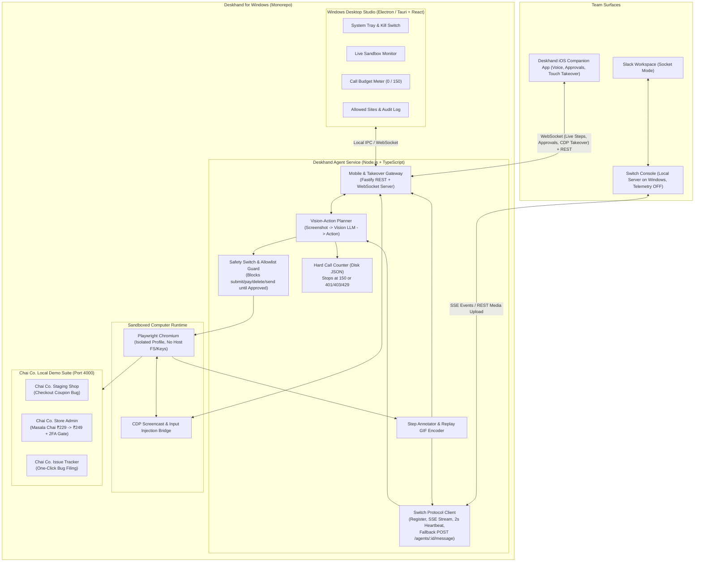

# Deskhand for Windows — End-to-End Product & Engineering Plan

> **Product Role:** Agent Host, Sandboxed Computer Controller, Switch Protocol Bridge & Desktop Studio  
> **Team Allocation:** 2 Windows Engineers (`Win-Dev 1` & `Win-Dev 2`)  
> **Target Stack:** TypeScript, Node.js 22, Playwright (Chromium), Tauri / Electron + React (Desktop Studio UI), Fastify + WebSocket (iOS & Switch Bridge), sharp / gif-encoder-2  
> **Hackathon Deadline:** November 7, 2026, 11:59 PM IST (Target submission: **Nov 7, 8:00 PM IST**)  
> **Track:** 01 — Best Business Workflow (*Flip the Switch Hackathon*)

---

## 1. Executive Summary & Product Vision

**Deskhand for Windows** is the engine room of the Deskhand ecosystem. It runs on a Windows machine alongside the **Switch Console local server** (with telemetry disabled) and provides the team's AI teammate with **its own sandboxed computer**.

When a teammate in Slack, Discord, or the **Deskhand iOS Companion App** asks Deskhand to reproduce a staging bug, update a price in a legacy admin portal, or fill out a vendor form:
1. **Deskhand Windows Host** receives the event from the Switch room (acting only when `addressed === true`).
2. It launches or reuses an isolated Playwright Chromium session restricted to an explicit **Domain Allowlist**.
3. It executes a **Vision-Action Loop**: capturing screenshots, grounding UI elements via a Vision LLM, executing clicks/keystrokes, and streaming annotated step screenshots back to the Switch thread and iOS app.
4. Before any high-risk action (`submit`, `pay`, `delete`, `send`), its deterministic + model-backed **Safety Switch** pauses execution and broadcasts an **Approve / Not now** gate to the thread and iOS app.
5. If blocked by a 2FA code or CAPTCHA-like login challenge on an internal portal, it spins up a **Live Takeover Session** so a teammate on iOS or desktop can tap in, type the code, and hand control back.
6. A local **Windows Desktop Studio (Tray + Dashboard)** gives the operator real-time visibility into the sandboxed screen, the **Hard Call Budget (`150` calls max persisted on disk)**, domain allowlist rules, and an emergency hardware-style kill switch.

---

## 2. System Architecture (Windows Host & Ecosystem Bridge)



---

## 3. Repository & Module Structure

To allow **2 Windows developers** and **2 iOS developers** to work in parallel without merge conflicts, the Windows codebase is organized as a clean TypeScript workspace inside the repository:

```text
deskhand/
├── apps/
│   ├── agent-host/              # Core Node.js + TypeScript Agent Service
│   │   ├── src/
│   │   │   ├── switch/          # Win-Dev 2: Switch registration, SSE, 2s heartbeat, fallback route
│   │   │   ├── gateway/         # Win-Dev 2: REST + WS API for iOS app & Windows Desktop Studio
│   │   │   ├── computer/        # Win-Dev 1: Playwright controller, CDP screencast, input injection
│   │   │   ├── vision/          # Win-Dev 1: Vision LLM prompt, coordinate grounding, action parser
│   │   │   ├── safety/          # Win-Dev 1: Allowlist guard + Risk classifier (submit/pay/delete/send)
│   │   │   ├── budget/          # Win-Dev 1: Atomic disk counter (max 150 calls, 401/403/429 tripwire)
│   │   │   ├── media/           # Win-Dev 1: Screenshot cursor overlay + Replay GIF generator
│   │   │   └── stt/             # Win-Dev 2: Voice note audio transcription fallback handler
│   ├── windows-studio/          # Win-Dev 2: Tauri/Electron + React Windows Operator Dashboard & Tray
│   └── chai-co-demos/           # Win-Dev 2: Self-contained demo apps (Shop, Admin Panel, Issue Tracker)
├── packages/
│   └── shared-protocol/         # Shared TypeScript types & JSON schemas (used by Windows & iOS)
├── data/
│   └── call-budget.json         # Persistent disk counter for the 150-call hard cap
├── WINDOWS_PRODUCT_PLAN.md
└── IOS_PRODUCT_PLAN.md
```

---

## 4. Detailed Feature Specifications (Windows Product)

### 4.1 Switch Protocol Connector & Fallback Router (`Win-Dev 2`)
- **Single Registration:** Registers Deskhand once against the local Switch server and persists `agentId` and credentials locally.
- **Heartbeat Daemon:** Sends a lightweight heartbeat every `2000 ms` with automatic jitter backoff and connection health telemetry to the Windows Studio UI.
- **Event Stream Filtering:** Listens to the room event stream and strictly ignores messages unless `addressed === true` (or an explicit approval/takeover callback matches an active `taskId`).
- **Media & Threading:** Uploads step screenshots (`PNG`) and end-of-run replay `GIF`s via Switch's media upload API and posts structured replies via `post_message` in the originating thread.
- **Noon Nov 6 Protocol Fallback:** Implements a feature flag `SWITCH_MODE=stream | rest_fallback`. If the Switch event stream exhibits instability by Nov 6 at 12:00 PM IST, toggles immediately to Switch's `POST /agents/{id}/message` route without changing a single line of the computer loop.

### 4.2 Sandboxed Computer Runtime & Vision-Action Loop (`Win-Dev 1`)
- **Isolated Browser Environment:** Runs Playwright Chromium in a locked-down browser context (`acceptDownloads: false`, isolated user data dir, blocked `file://` and local intranet ranges except the allowlisted demo ports).
- **Deterministic Viewport:** Fixed `1280x800` viewport so vision coordinates (`x, y`) and iOS touch takeover coordinates map `1:1` without scaling drift.
- **Vision-Action Cycle (1 Model Call per Step, ~8–12 Steps per Task):**
  1. Capture viewport screenshot + extract interactive DOM accessibility metadata (buttons, inputs, labels with bounding boxes) to make clicking near-100% reliable.
  2. Check **Hard Call Counter** (`budget.json`) before invoking the Vision model.
  3. Send screenshot + compact element map to Vision LLM; receive structured JSON action:
     ```json
     {
       "thought": "Typed 249 into the Masala Chai price input. Next step clicks 'Save Changes'.",
       "action": { "type": "click", "x": 642, "y": 518, "selectorHint": "#save-price-btn" },
       "riskLevel": "HIGH",
       "riskReason": "Submits price update from ₹229 to ₹249 in Store Admin",
       "needsHumanTakeover": false
     }
     ```
  4. Draw a high-visibility click ripple / bounding box onto the screenshot and stream it immediately to the Switch thread and iOS app.

### 4.3 Safety Switch & Allowed-Sites Engine (`Win-Dev 1`)
- **Strict Domain Allowlist:** Before every navigation or click that triggers a URL change, the URL hostname is validated against `allowlist.json` (default: `localhost:4000`, `shop.chaico.local`, `admin.chaico.local`, `issues.chaico.local`). Any navigation outside the list is aborted and reported in chat.
- **Dual-Layer Risk Gate:**
  - **Layer 1 (Deterministic Code Rule):** Inspects target button/form text and DOM attributes for `type="submit"` or keywords (`save`, `submit`, `pay`, `checkout`, `delete`, `remove`, `send`, `update price`, `publish`).
  - **Layer 2 (Vision Model Classification):** Vision output marks `riskLevel: "HIGH"`.
  - When either triggers, the agent **freezes the Playwright page**, saves a pending state snapshot, and emits an `APPROVAL_REQUIRED` event to Switch and the iOS Companion App:
    > *"Change Masala Chai from ₹229 to ₹249? [Approve] / [Not now]"*
  - Only when a teammate with an authorized role (`admin`, `ops-lead`, `qa-lead`) responds with Approve in Slack/Switch or taps **Approve** on iOS does the loop execute the click.

### 4.4 Live Screen Takeover Server (`Win-Dev 1` + `Win-Dev 2`)
- When Deskhand detects a login OTP/2FA screen or receives `@deskhand pause, I'll do this bit`:
  1. Deskhand pauses the autonomous loop and transitions task state to `HUMAN_TAKEOVER`.
  2. Starts a Chrome DevTools Protocol (`Page.startScreencast`) session at 10–15 FPS (JPEG quality 70) piped over the local WebSocket Gateway (`/ws/takeover/:taskId`).
  3. Generates a short-lived signed takeover URL (works in desktop browser **and** opens natively inside the Deskhand iOS app's Touch Takeover Canvas).
  4. Translates remote touch/mouse (`Input.dispatchMouseEvent`) and keystrokes (`Input.dispatchKeyEvent`) directly into the paused Playwright page.
  5. When the user taps **"Hand Back to Deskhand"**, screencast input locks and the Vision loop resumes from the updated screen state.

### 4.5 Hard Call-Cap & Cost Circuit Breaker (`Win-Dev 1`)
- Stored in `data/call-budget.json`:
  ```json
  {
    "maxCalls": 150,
    "usedCalls": 42,
    "breakdown": { "vision": 38, "stt": 4 },
    "halted": false,
    "haltReason": null
  }
  ```
- Synchronous file lock + atomic write before every AI API request.
- Immediately halts the service and alerts the Windows Studio UI and chat thread if:
  - `usedCalls >= maxCalls` (`150` default), OR
  - Any provider response returns HTTP `401`, `403`, or `429`.

### 4.6 "Chai Co." Demo Application Suite (`Win-Dev 2`)
Built as a single fast local server (`apps/chai-co-demos` on port `4000`) with clean, deterministic, high-contrast UI optimized for Vision LLM accuracy:
1. **Chai Co. Local Demo Shop (`/shop`):**
   - Responsive product catalog featuring *Masala Chai Tin (₹229)* and *Cardamom Morning Brew (₹199)*.
   - Working in-memory basket with quantity controls, subtotal, delivery estimate, discount-code feedback, and a disabled checkout button while empty. Entering `CHAI50` and continuing to checkout reproduces a readable checkout error with expandable technical evidence (`CouponDiscountOverflowException at CheckoutController.ts:142`).
2. **Chai Co. Store Admin Portal (`/admin`):**
   - Includes a toggleable **2FA Login Code Challenge** screen (for Demo Story Part 3: Takeover) and the Product Inventory table where *Masala Chai* price (`₹229`) can be edited to `₹249` and saved via a prominent **Save Price Update** button.
3. **Chai Co. Issue Tracker (`/issues`):**
   - Responsive local issue list and detail pages, with a **New Issue** form for a short description, severity, and reproduction steps. Reports receive a sequential `CHAI-*` identifier. Screenshot attachments are not implemented in this demo.

> **Demo boundary:** The shop does not take payment or create real orders. Prices and issues are held in memory and reset when the demo server restarts. These pages demonstrate Deskhand workflows; they are not production commerce or issue-tracking services.

### 4.7 Windows Desktop Studio UI (`Win-Dev 2`)
A sleek desktop window + Windows system tray utility (Tauri / Electron + React):
- **Live Computer Monitor:** Watch Deskhand's sandboxed Chromium browser in real time with an overlay showing current step thought and target coordinates.
- **Call Budget Gauge:** Progress bar showing `Used / 150` calls (`Building`, `Rehearsal`, `STT`) with a manual reset/cap config require confirmation.
- **Switch & iOS Connection Status:** Green/amber indicators for Switch Console heartbeat, Slack Socket Mode, and connected iOS Companion devices.
- **Emergency Pause / Kill Switch:** Global hotkey (`Ctrl+Shift+K`) and red tray button to freeze Playwright immediately.

---

## 5. Two-Developer Work Split (Windows Team)

| Area | `Win-Dev 1` (Runtime, Vision & Safety Lead) | `Win-Dev 2` (Switch Protocol, Gateway, Studio UI & Demo Apps Lead) |
|---|---|---|
| **Primary Focus** | The "Brain & Hands" — Playwright, Vision LLM, Safety Gate, Call Budget, Takeover CDP, Replay GIF | The "Nervous System & Stage" — Switch Connector, iOS WebSocket Gateway, Windows Studio App, Chai Co. Demo Sites |
| **Owned Directories** | `apps/agent-host/src/{computer,vision,safety,budget,media}` | `apps/agent-host/src/{switch,gateway,stt}`, `apps/windows-studio`, `apps/chai-co-demos` |
| **Shared Contract** | `packages/shared-protocol/src/index.ts` (Frozen Nov 5, 9:00 PM IST with iOS team) | `packages/shared-protocol/src/index.ts` |
| **Model Budget Responsibility** | Enforces the `150` hard cap and builds a **Mock Vision Replay Mode** so UI/Switch tests use `0` API calls | Uses Mock Vision Mode during Switch, Windows UI, and iOS integration testing |

---

## 6. Hackathon Execution Timeline (Nov 5 – Nov 7 IST)

### Day 1: Thursday, Nov 5 (Evening: 6:00 PM – 12:00 AM IST)
- **6:00 PM – 7:30 PM:**
  - **Operator/User:** Registers on WeMakeDevs, installs Switch Console (Local Server mode, **Share usage data = OFF**), creates Slack workspace + Switch app via manifest.
  - **`Win-Dev 1` + `Win-Dev 2` + iOS Devs:** Lock `packages/shared-protocol` JSON schemas for Tasks, Steps, Approval Requests, and Takeover Frames.
- **7:30 PM – 10:00 PM:**
  - **`Win-Dev 1`:** Implement `budget/` hard call counter (`150` max, `401/403/429` tripwire) and Playwright sandbox launcher (`1280x800`, domain allowlist interceptor).
  - **`Win-Dev 2`:** Build the 3 **Chai Co. Demo Apps** (`/shop` with coupon bug, `/admin` with price edit + 2FA screen, `/issues` tracker) on `localhost:4000`.
- **10:00 PM – 12:00 AM:**
  - **`Win-Dev 2`:** Implement Switch agent registration, 2s heartbeat, event listener (`addressed === true`), and echo reply in `#ops`. Start WebSocket gateway for iOS team.
  - **`Win-Dev 1`:** Build screenshot capture + coordinate highlighter (`sharp`) and Mock Vision Runner (zero API calls) so iOS and Switch can test end-to-end flows overnight.

### Day 2: Friday, Nov 6 (Morning to Night)
- **Morning (8:00 AM – 1:00 PM IST) — The Computer Loop:**
  - **`Win-Dev 1`:** Connect live Vision LLM to Playwright loop. Tune prompt + DOM bounding-box hints so Demo Flow 1 (Chai Co. coupon bug reproduction + issue filing) and Demo Flow 2 (Admin price change) succeed in $\le 8$ steps each.
  - **`Win-Dev 2`:** Complete Switch media upload for step screenshots into `#ops` thread. **12:00 PM Checkpoint:** Verify Switch event stream reliability; if flaky, flip `SWITCH_MODE=rest_fallback` (`POST /agents/{id}/message`).
- **Afternoon (1:00 PM – 6:00 PM IST) — Safety Switch, Approvals & Voice Notes:**
  - **`Win-Dev 1`:** Wire the deterministic + vision **Safety Switch** (`submit`, `pay`, `delete`, `send`) and Domain Allowlist enforcement. Test pausing Playwright right before clicking **Save Price Update (₹229 → ₹249)**.
  - **`Win-Dev 2`:** Wire approval resolution from both Slack/Switch thread replies ("Approve" / "Not now" with role check) and iOS Companion App 1-tap approval endpoint. Add STT handler for incoming voice notes.
- **Night (6:00 PM – 11:30 PM IST) — Live Takeover, Replay GIF & Windows Studio:**
  - **`Win-Dev 1`:** Implement CDP screencast + remote mouse/keyboard injection for Demo Flow 3 (2FA Login Code Takeover) and `gif-encoder-2` summary GIF generator at task completion.
  - **`Win-Dev 2`:** Build the **Windows Desktop Studio UI** (Live viewport mirror, Call Budget gauge `Used/150`, Allowlist viewer, Kill Switch) and verify iOS Touch Takeover end-to-end with the iOS team.

### Day 3: Saturday, Nov 7 (Morning to 8:00 PM IST)
- **Morning (8:00 AM – 12:30 PM IST) — Full Rehearsals & Recording:**
  - Run full dress rehearsals of all 3 demo scenes across Slack `#ops`, Windows Host Studio, and iOS Companion App.
  - Monitor call counter closely (keep total build + rehearsal usage well inside the `150` cap).
  - Record multi-take high-resolution screen captures of Windows Studio + Slack `#ops` synchronized with iOS recordings.
- **Afternoon (12:30 PM – 6:00 PM IST) — Video Edit, Architecture Diagrams & Final QA:**
  - **`Win-Dev 1` & `Win-Dev 2`:** Finalize root `README.md`, architecture diagrams, MIT license verification, clean git history check (zero proprietary or Switch-copied code, zero leaked keys).
- **By 8:00 PM IST (4 Hours Buffer Before 11:59 PM Deadline):**
  - Push to public GitHub repo and submit on WeMakeDevs.

### Strict Cut Order (If Behind Schedule)
1. **Cut 1 (First to drop if delayed past Nov 6, 9:00 PM):** Interactive CDP Screencast Takeover → fallback to a 1-step "Reply with the 6-digit login code in thread/iOS sheet and Deskhand types it".
2. **Cut 2:** Animated Replay GIF at the end of the thread (keep per-step annotated PNG screenshots).
3. **Cut 3:** Server-side STT fallback (rely on iOS native on-device Speech-to-Text which uses `0` API calls).
4. **NEVER CUT:**
   - Story 1: Staging Shop Coupon Bug Reproduction + Issue Filing.
   - Story 2: Store Admin Masala Chai Price Update (`₹229 → ₹249`) with **Approve / Not now** Safety Switch.

---

## 7. Shared API & WebSocket Contracts (Windows Host ↔ iOS App)

The Windows Agent Host exposes a local Fastify + WebSocket server on port `4100` (accessible to the iOS device on the same LAN or via local tunnel):

### REST Endpoints
- `GET /api/status` → `{ switchConnected, activeTask, budget: { used, max: 150, halted }, allowlist: string[] }`
- `POST /api/tasks` → Trigger a task from text or transcribed voice note `{ prompt, senderName, senderRole, source: "ios_voice" | "ios_text" }`
- `POST /api/tasks/:taskId/approval` → `{ decision: "approve" | "reject", responderName, responderRole }`
- `POST /api/tasks/:taskId/takeover/release` → Hands control back from human to Deskhand Vision loop.
- `POST /api/kill` → Emergency pause/abort of active Playwright session.

### WebSocket Events (`ws://<windows-host>:4100/ws`)
- `task:started` / `task:step` (includes `stepNumber`, `thought`, `screenshotUrl`, `action`)
- `task:approval_required` (includes `taskId`, `summary`, `diff`: `"₹229 → ₹249"`, `screenshotUrl`, `allowedRoles`)
- `task:takeover_requested` (includes `taskId`, `reason`: `"2FA Login Code Required"`, `takeoverWsUrl`)
- `task:completed` (includes `summary`, `replayGifUrl`, `callCountUsed`)
- `takeover:frame` (binary/base64 JPEG frame from CDP) & `takeover:input` (`{ type: "tap" | "type" | "key", x, y, text }`)

---

## 8. Post-Hackathon Production Roadmap (Windows Product)

| Phase | Milestone | Key Capabilities |
|---|---|---|
| **Phase 1: V1.0 Team Pilot (Weeks 1–4)** | Hardened Windows Agent Service & Installer | Signed `.msi` / `.exe` Tauri installer, Windows Credential Manager integration for encrypted vault injection (so Deskhand logs into vendor portals without exposing passwords to the LLM), persistent SQLite audit log. |
| **Phase 2: V1.5 Native Windows OS Automation (Weeks 5–8)** | Beyond the Browser (Win32 / WPF / Legacy ERPs) | Add Windows UI Automation (`UIA` / `pywinauto` / C# native bridge) inside Windows Sandbox (`.wsb`) or Hyper-V lightweight VM so Deskhand can operate legacy desktop accounting/ERP software alongside Chromium. |
| **Phase 3: V2.0 Enterprise Fleet & RBAC (Weeks 9–12)** | Multi-Worker Pool & Compliance | Concurrent isolated browser workers per department (`#finance`, `#qa`, `#ops`), SSO/Entra ID role verification for approvals, SOC2 tamper-evident video & action logs. |

